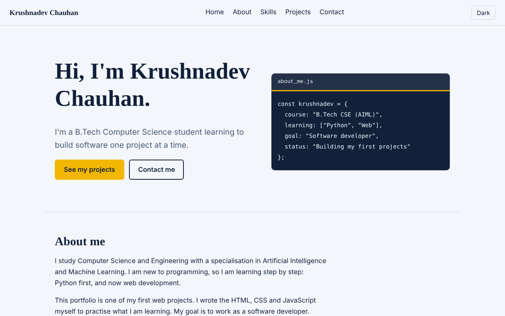

# Krushnadev Chauhan - Portfolio

A personal portfolio website made for the Web Technology internal assessment (B.Tech CSE - AIML).
It tells visitors who I am, what I am learning, and shows my first projects.

## Technologies used

- **HTML5**: page structure with `header`, `nav`, `main`, `section`, `article` and `footer` tags, and a contact form
- **CSS3**: separate `style.css` with element, class and id selectors, hover effects, a light and dark colour theme, and a responsive layout (media queries)
- **JavaScript**: separate `script.js` using event listeners
- **Git and GitHub**: for version control

## Features

- Sections: Home, About, Skills, Projects and Contact
- **Dark mode button** that remembers the choice for the next visit
- **Menu button** that opens and closes the navigation on mobile screens
- **Contact form check**: name, email and message are validated before submitting
- Works on both mobile and laptop screens

## Files

| File | Purpose |
|------|---------|
| `index.html` | Content and structure of the page |
| `style.css` | All the styling |
| `script.js` | Dark mode, mobile menu and form checking |
| `screenshot.png` | Screenshot used in this README |

## How to run

Download or clone this repository and open `index.html` in any web browser. No installation is needed.

## Live website

Add the GitHub Pages link here after publishing: `https://YOUR-USERNAME.github.io/Krushnadev_Chauhan_268405_Portfolio/`

## Author

Krushnadev Chauhan - B.Tech CSE (AIML)
